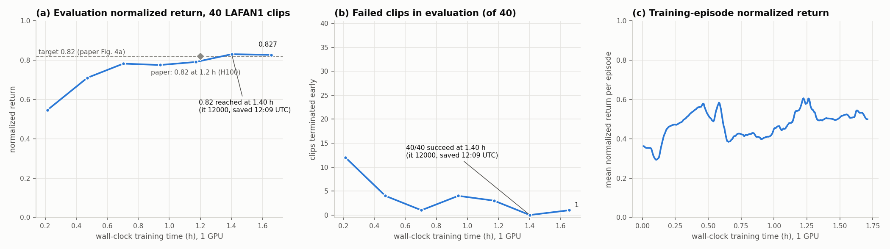

# SuperMimic 复现：Isaac Lab 3（kit-less，MuJoCo-Warp）—— 中文新手版

[English](README.md) | 中文

**非官方**复现论文 *SuperMimic: Scaling Humanoid Whole-Body Control with One Differentiable World
Model*（arXiv 2610.28480）。论文没有公开代码，本仓库全部按论文实现。目标实验是论文 Fig. 4a 的
LAFAN1 对照实验：40 段重定向到 Unitree G1 的 LAFAN1 动作（共 2.45 小时），单 GPU；论文在 H100 上
1.2 小时训练后评估归一化回报（normalized return）达到 0.82。

原作者：**Chong Zhang**（ETH Zurich）。许可证：[MIT](LICENSE)。

> **免责声明（原作者）：** 这个仓库是用 AI 编程助手在 1 小时内"速写"出来的，没有经过审查，
> 请自行承担使用风险。

> **一个 G1 动作跟踪策略覆盖全部 40 段 LAFAN1 动作，只需约 1.5 GPU 小时**
> （原作者在单张 RTX PRO 6000 上 1.47 h）：评估回报 **0.829**，**0/40 段失败**。
> 本中文文档作者按下面步骤在 **单张 RTX 4090（24 GB）** 上完整重跑了一遍，结果见
> [本机复现结果](#本机复现结果rtx-4090)。


*实体机器人：训练好的策略在 Isaac Lab + MuJoCo-Warp 中仿真。蓝色幽灵：参考动作。
动作片段：舞蹈、跳跃、摔倒再爬起、冲刺。*

里程碑与时间线（原作者）：[MILESTONES.md](MILESTONES.md)。

---

## 目录

- [整体流程一览](#整体流程一览)
- [目录结构](#目录结构)
- [第 0 步：宿主机准备（驱动 / Docker / NVIDIA Container Toolkit）](#第-0-步宿主机准备)
- [第 1 步：构建 Isaac Lab kit-less 镜像](#第-1-步构建-isaac-lab-kit-less-镜像)
- [第 2 步：启动常驻容器](#第-2-步启动常驻容器)
- [第 3 步：下载数据并转换机器人资产](#第-3-步下载数据并转换机器人资产)
- [第 4 步：环境自检](#第-4-步环境自检)
- [第 5 步：训练](#第-5-步训练)
- [第 6 步：评估](#第-6-步评估)
- [第 7 步：在浏览器（viser）里播放 mimic 结果](#第-7-步在浏览器viser里播放-mimic-结果)
- [第 8 步（可选）：画曲线 / 渲染 mp4](#第-8-步可选画曲线--渲染-mp4)
- [踩坑记录（必读）](#踩坑记录必读)
- [本机复现结果（RTX 4090）](#本机复现结果rtx-4090)
- [实现说明（论文章节 → 文件）](#实现说明论文章节--文件)
- [与论文的偏差 / 论文未指定的选择](#与论文的偏差--论文未指定的选择)
- [引用与许可](#引用与许可)

---

## 整体流程一览

所有命令都在**仓库根目录**（`supermimic_vibed/`）下执行。按顺序复制粘贴即可：

```bash
# 0. 宿主机检查（详见第 0 步）
nvidia-smi
docker run --rm --gpus all docker.m.daocloud.io/library/ubuntu:22.04 nvidia-smi

# 1. 构建镜像（约 30–40 分钟，国内网络加 DOCKER_MIRROR）
DOCKER_MIRROR=docker.m.daocloud.io tools/setup.sh

# 2. 启动常驻容器（GPU 0，内存上限 128 GB，viser 端口 8080）
docker/run_container.sh 0 128g

# 3. 下载数据 + 转换机器人模型（约 3 分钟）
tools/download_data.sh

# 4. 自检
docker exec supermimic python tools/test_env.py

# 5. 训练（tmux 会话 lafan1_main，约 1.5–2 小时到可用结果）
./run_train.sh lafan1_main
docker exec supermimic tmux new -d -s eval_main "cd /workspace/supermimic && python supermimic/evaluate.py --run_dir logs/lafan1_main --watch 2>&1 | tee -a logs/lafan1_main/eval_stdout.log"

# 6. 训练到 eval.csv 里出现满意的 checkpoint 后（本次是 it 12000），录制轨迹
docker exec supermimic python supermimic/evaluate.py --run_dir logs/lafan1_main \
    --ckpt logs/lafan1_main/ckpt_012000.pt --record logs/lafan1_main/traj_012000.npz

# 7. 用 viser 播放，浏览器打开 http://localhost:8080
docker exec -it supermimic python tools/viser_play.py logs/lafan1_main/traj_012000.npz \
    --eval logs/lafan1_main/ckpt_012000_eval.json
```

下面逐步解释每一步、它需要什么、以及我实际踩到的坑。

---

## 目录结构

| 路径 | 内容 |
|---|---|
| `IsaacLab/` | Isaac Lab `main` @ 46d6cc3（VERSION 3.0.0），未修改 —— 由 `tools/setup.sh` 克隆，不入库 |
| `docker/` | `Dockerfile`：`supermimic:latest` = `isaac-lab-kitless:main-46d6cc3`（由 `IsaacLab/docker/Dockerfile.kitless` 构建）+ tmux、ffmpeg、gcc（`torch.compile` 需要）；`run_container.sh` 启动容器 |
| `data/` | 不入库；`tools/download_data.sh` 下载 LAFAN1 G1 重定向数据（HF `lvhaidong/LAFAN1_Retargeting_Dataset`）和 G1 URDF/网格，然后生成 `g1_29dof.xml`（MJCF）和 USD |
| `supermimic/` | 算法实现（见下文） |
| `tools/` | 环境搭建、资产转换、测试、基准、画图、渲染、失败分析、**viser 播放（`viser_play.py`，本次新增）** |
| `logs/<run>/` | 不入库：`train_log.csv`、`eval.csv`、checkpoint、stdout。用 `--log_dir` 指定，或用 `--exp_name <实验> --run_name <名称>` 得到 `logs/<实验>/<YYYY-mm-dd_HH-MM-SS>_<名称>/` 和指向最新一次的 `latest`（见 `retarget/README.md` §3） |
| `results/` | 成功率曲线和演示 GIF |

---

## 第 0 步：宿主机准备

**硬件 / 系统要求**

| 项目 | 要求 | 本次实测环境 |
|---|---|---|
| 系统 | Linux x86_64 | Ubuntu，内核 6.8 |
| GPU | NVIDIA，训练时需要 **≥ 20 GB 空闲显存**（默认 4096 并行环境，实测占用 17.3 GB，评估监视器同卡再加约 1.7 GB） | RTX 4090 24 GB |
| 驱动 | 支持 CUDA 13（镜像内 PyTorch 为 `2.11.0+cu130`），即驱动 ≥ 580 | 580.173 / CUDA 13.0 |
| 内存 | 容器默认上限 128 GB（实际训练常驻内存只有几 GB） | 188 GB |
| 硬盘 | 镜像约 20 GB（`supermimic:latest` 19.4 GB，与 kit-less 镜像共享层）+ 构建缓存；数据 0.12 GB；每个 checkpoint 72 MB（每 2000 iter 一个）+ `last.pt` 218 MB；每份录制轨迹约 140 MB。**建议预留 ≥ 40 GB** | — |
| 网络 | 需要访问 GitHub、PyPI、pypi.nvidia.com、download.pytorch.org、ghcr.io、huggingface.co；Docker Hub 可用镜像源替代 | 国内网络，Docker Hub 不通 |

**0.1 检查 NVIDIA 驱动**

```bash
nvidia-smi          # 能看到 GPU，右上角 CUDA Version ≥ 13.0
```

> 坑：如果别的进程（比如推理服务、别人的训练）占着显存，训练会 OOM。用 `nvidia-smi` 看清楚哪张卡
> 空闲，第 2 步启动容器时把对应编号传进去。

**0.2 安装 Docker（已安装可跳过）**

```bash
curl -fsSL https://get.docker.com | sudo sh                 # 国内网络可加：sudo sh -s -- --mirror Aliyun
sudo usermod -aG docker $USER && newgrp docker               # 让当前用户不用 sudo 就能 docker
docker --version
```

**0.3 安装 NVIDIA Container Toolkit（已安装可跳过）**

```bash
curl -fsSL https://nvidia.github.io/libnvidia-container/gpgkey | sudo gpg --dearmor -o /usr/share/keyrings/nvidia-container-toolkit-keyring.gpg
curl -s -L https://nvidia.github.io/libnvidia-container/stable/deb/nvidia-container-toolkit.list | \
  sed 's#deb https://#deb [signed-by=/usr/share/keyrings/nvidia-container-toolkit-keyring.gpg] https://#g' | \
  sudo tee /etc/apt/sources.list.d/nvidia-container-toolkit.list
sudo apt-get update && sudo apt-get install -y nvidia-container-toolkit
sudo nvidia-ctk runtime configure --runtime=docker
sudo systemctl restart docker
```

**0.4 验证容器能用 GPU（必须通过）**

```bash
# 国内用 daocloud 镜像源拉 ubuntu；能直连 Docker Hub 的话把前缀去掉即可
docker run --rm --gpus all docker.m.daocloud.io/library/ubuntu:22.04 nvidia-smi
```

能打印出 GPU 信息即可。

> 注：`docker info` 里的 Runtimes 一栏没有 `nvidia` 也没关系，只要上面这条命令能看到 GPU 就行（本机就是这样）。

**0.5 宿主机其他小工具**

```bash
sudo apt-get install -y git curl python3      # download_data.sh 在宿主机上用 curl + python3 解析 HF 文件列表
```

**0.6 克隆本仓库**

```bash
git clone <本仓库地址> supermimic_vibed
cd supermimic_vibed
```

---

## 第 1 步：构建 Isaac Lab kit-less 镜像

代码运行在 Isaac Lab 3 `main` 分支 commit
[`46d6cc3`](https://github.com/isaac-sim/IsaacLab/commit/46d6cc3d7b115906fad12efd372fbf69f4e3d3ed)
（VERSION 3.0.0，未修改），在 Isaac Lab 的 **kit-less** 镜像里（没有 Isaac Sim / Kit，没有 PhysX）。
更新的 `main` 可能也能用，但未测试。

物理引擎：Newton + MuJoCo-Warp 求解器（`NewtonCfg(MJWarpSolverCfg(...))`）；50 Hz 控制，
每步 4 个 5 ms 子步，implicitfast 积分器，MuJoCo 碰撞管线。

**能直连 Docker Hub：**

```bash
tools/setup.sh
```

**国内网络（Docker Hub 不通）：**

```bash
DOCKER_MIRROR=docker.m.daocloud.io tools/setup.sh
```

`tools/setup.sh` 做的事情等价于：

```bash
git clone https://github.com/isaac-sim/IsaacLab.git
git -C IsaacLab checkout 46d6cc3d7b115906fad12efd372fbf69f4e3d3ed
# 两个 --build-arg 只有设置了 DOCKER_MIRROR 时才会加
(cd IsaacLab && docker build -f docker/Dockerfile.kitless \
    --build-arg BUILDKIT_SYNTAX=docker.m.daocloud.io/docker/dockerfile:1 \
    --build-arg BASE_IMAGE_ARG=docker.m.daocloud.io/library/ubuntu:24.04 \
    -t isaac-lab-kitless:main-46d6cc3 .)
docker build -t supermimic:latest docker/     # + tmux, ffmpeg, gcc, NVIDIA EGL vendor 文件
```

- 耗时：本机约 **30 分钟**（绝大部分是 `uv sync` 从 PyPI 下载 torch、CUDA 库等几 GB 的 wheel），
  `supermimic:latest` 再约 5 分钟（apt 装 tmux/ffmpeg/gcc）。
- `kit-less` 构建中途如果因为 GitHub 网络断开失败，脚本会自动重试（默认 3 次，可用
  `BUILD_RETRIES=5` 调整）。详见[坑 2](#坑-2uv-sync-从-github-拉-rl_games-时断线)。

验证：

```bash
docker images | grep -E "supermimic|kitless"
# isaac-lab-kitless   main-46d6cc3   ...  18.7GB
# supermimic          latest         ...  19.4GB
```

---

## 第 2 步：启动常驻容器

```bash
docker/run_container.sh 0 128g     # 参数：GPU 编号（这里用 0 号卡）、容器内存上限
```

- 仓库被挂载到容器内的 `/workspace/supermimic`，容器名固定为 `supermimic`，之后所有命令都是
  `docker exec supermimic ...`。
- 本次在 `run_container.sh` 里**新增了端口映射** `-p 8080:8080`，给第 7 步的 viser 用。
  8080 被占用时：`VISER_PORT=8090 docker/run_container.sh 0 128g`，然后浏览器访问 8090。
- 想换卡或改端口，必须先删掉旧容器（端口映射只能在创建时指定）：

```bash
docker rm -f supermimic
docker/run_container.sh 1 128g     # 例如改用 1 号卡
```

验证：

```bash
docker exec supermimic nvidia-smi -L
docker exec supermimic python -c "import torch, viser, mujoco, warp; print(torch.__version__, torch.cuda.is_available(), viser.__version__, mujoco.__version__, warp.__version__)"
# 本机输出：2.11.0+cu130 True 1.0.30 3.15.0 1.17.0
```

---

## 第 3 步：下载数据并转换机器人资产

| 内容 | 来源 | 许可 | 存放位置 |
|---|---|---|---|
| 40 段重定向到 29 自由度 G1 的 LAFAN1 动作（30 fps CSV：根位置、根四元数 xyzw、29 个关节角） | HF [`lvhaidong/LAFAN1_Retargeting_Dataset`](https://huggingface.co/datasets/lvhaidong/LAFAN1_Retargeting_Dataset)，`g1/` 文件夹 | CC BY-NC-ND 4.0（Ubisoft La Forge） | `data/lafan1_g1/*.csv` |
| G1 描述 `g1_29dof_rev_1_0.urdf` + 网格（动作就是重定向到这个模型的） | 同一数据集，`robot_description/g1/` | BSD-3-Clause（Unitree） | `data/g1_description/` |

**前提：第 2 步的容器必须已经在运行**（脚本最后一步在容器里做模型转换）。

```bash
tools/download_data.sh
```

脚本做了这些事：

1. 在宿主机上用 `curl` 从 huggingface.co 下载 40 个 CSV、URDF 和 38 个 STL 网格（本机约 2.5 分钟，共约 113 MB）；
2. 在容器里运行 `tools/urdf_to_mjcf.py`：把 URDF 编译成 `data/g1_description/g1_29dof.xml`（骨盆自由浮动）；
3. 在容器里运行 `tools/mjcf_to_usd.py`：把 MJCF 转成 `data/g1_usd/g1_29dof/g1_29dof.usda`，Isaac Lab 加载的就是它。
   转换必须离线做，因为 kit-less 的导入器无法在 Isaac Lab 进程内运行（见"偏差"一节）。

预期结果：

```
data/
├── lafan1_g1/                  40 个 CSV（dance, fallAndGetUp, fight, jumps, run, sprint, walk）
├── g1_description/
│   ├── g1_29dof_rev_1_0.urdf
│   ├── g1_29dof.xml            生成的 MJCF
│   └── meshes/*.STL            38 个网格
└── g1_usd/g1_29dof/            生成的 USD（+ payloads/）
```

检查：

```bash
ls data/lafan1_g1 | wc -l                                   # 40
ls data/g1_description/meshes | wc -l                       # 38
ls data/g1_usd/g1_29dof/g1_29dof.usda                       # 存在
```

`urdf_to_mjcf.py` 的正常输出：`nq 36 nv 35 nbody 40 ngeom 71 mass 33.34...`。
40 段动作共 264,705 帧 @30 fps（2.45 小时）。

> 坑：数据集只能直连 huggingface.co。我测试过 `hf-mirror.com`，它对这个数据集的 tree API 返回空列表，
> 所以脚本没法直接换成镜像。连不上 HF 时请先给终端设代理（`export https_proxy=http://<代理地址>`）再运行。

---

## 第 4 步：环境自检

```bash
docker exec supermimic python tools/test_env.py
```

第一次运行会编译 Warp kernel（缓存到 `.cache/warp`），大约 1–2 分钟。关键输出（本机实测）：

```
roundtrip p: max err 0.00e+00        ← 状态写入 / 读出一致
FK pos err 6.497149911410816e-07     ← torch FK 与仿真器的连杆位姿一致（~1e-6 即正常）
FK rot err xyzw 0.0014  wxyz 3.14    ← 正常！脚本同时试两种四元数顺序，仿真器是 xyzw，wxyz 那项本来就是错的
FK linvel err 1.15e-06  angvel err 2.48e-06
ref body vs FK(sim) pos err 1.2e-07
0 norm reward ...  term frac 0.0
...
75 norm reward ... term frac 1.0     ← 正常！这是"开环"回放参考关节角（没有策略），机器人本来就会摔倒
```

> 坑：新手容易被 `wxyz 3.14` 和 `term frac 1.0` 吓到，**这两项都是预期结果**，不是错误。
> 真正要看的是 `FK pos err`、`FK linvel/angvel err` 都在 1e-6 量级。

---

## 第 5 步：训练

```bash
./run_train.sh lafan1_main                    # 在容器里的 tmux 会话 'lafan1_main' 中训练
# 可选：CPUS=0-23 ./run_train.sh lafan1_main  # 用 taskset 绑定 CPU 核
```

查看训练输出：

```bash
docker exec -it supermimic tmux attach -t lafan1_main     # 按 Ctrl+b 再按 d 退出（训练不会停）
# 或者直接在宿主机看日志：
tail -f logs/lafan1_main/stdout.log
```

同时启动评估监视器（每出现一个新 checkpoint 就在 40 段动作上各跑一遍并记录到 `eval.csv`）：

```bash
docker exec supermimic tmux new -d -s eval_main "cd /workspace/supermimic && python supermimic/evaluate.py --run_dir logs/lafan1_main --watch 2>&1 | tee -a logs/lafan1_main/eval_stdout.log"
cat logs/lafan1_main/eval.csv                              # 随时查看评估结果
```

**训练过程中会看到什么（本机 RTX 4090 实测）：**

| 阶段 | 现象 |
|---|---|
| 启动后 1–3 分钟 | 加载动作、初始化 MuJoCo-Warp、`torch.compile` 编译（缓存到 `.cache/inductor`，第二次启动会快很多） |
| it 0–500 | 只训练世界模型（`pi 0.000 v 0.0000`），约 6.9 it/s |
| it 500 之后 | 开始策略 + critic 更新，速度降到约 **2.66 it/s**（原作者 RTX PRO 6000 约 3.1 it/s）；评估监视器在同卡跑评估的那 3 分钟会掉到约 2.0 it/s |
| 每 2000 iter | 保存 `logs/lafan1_main/ckpt_XXXXXX.pt`，评估监视器约 3.5 分钟后写入 `eval.csv` |
| 显存 | 训练约 17.3 GB，加评估监视器约 19 GB |

日志字段：`wm` 世界模型损失，`e8` 8 步自回归误差，`imag_r` 想象轨迹奖励，`surv` 想象存活率，
`sim_r` / `ep_len` / `ep_ret` 仿真器中的奖励 / 回合长度 / 归一化回报，`term` 回合中因摔倒终止的比例。

**什么时候可以停？** 原作者的成功标准：`eval.csv` 里 `norm_return ≥ 0.82` **且** `n_failed = 0`
（40/40 段都不摔）。原作者在 it 14000（约 1.5 小时）达到。默认会一直训到 320k iter，达到目标后手动停止：

```bash
docker exec supermimic tmux kill-session -t lafan1_main
docker exec supermimic tmux kill-session -t eval_main
```

从中断处继续训练：

```bash
./run_train.sh lafan1_main --resume logs/lafan1_main/last.pt
```

---

## 第 6 步：评估

先挑 checkpoint：打开 `logs/lafan1_main/eval.csv`，选 `n_failed` 为 0 且 `norm_return` 最高的那一行。
本次运行是 **it 12000**（return 0.8308，0/40 失败），所以下面的命令都用 `ckpt_012000`；
你的运行结果可能不同（训练有随机性），把编号换成你自己的即可。

单独评估该 checkpoint，并**录制轨迹**（第 7 步播放用）：

```bash
docker exec supermimic python supermimic/evaluate.py --run_dir logs/lafan1_main \
    --ckpt logs/lafan1_main/ckpt_012000.pt --record logs/lafan1_main/traj_012000.npz
```

- 评估设置（论文附录 F.1）：每段动作从第一帧开始播一次，摩擦 1.0，无域随机化 / 噪声，确定性策略；
  触发训练时的终止条件即算失败。
- 录制时间约 5 分钟（要等最长的那段动作播完），生成约 140 MB 的 `.npz`。
- 评估监视器（`--watch`）会为每个 checkpoint 写 `ckpt_XXXXXX_eval.json`，里面有每段动作的归一化回报，
  第 7 步可以用 `--eval` 显示出来。

---

## 第 7 步：在浏览器（viser）里播放 mimic 结果

原仓库只有离线渲染 mp4 的 `tools/render.py`，本次新增了 **`tools/viser_play.py`**：
在浏览器里交互式播放第 6 步录制的轨迹。viser 已包含在 Isaac Lab kit-less 镜像中（1.0.30），不需要额外安装。

```bash
docker exec -it supermimic python tools/viser_play.py logs/lafan1_main/traj_012000.npz \
    --eval logs/lafan1_main/ckpt_012000_eval.json
```

然后在**宿主机**浏览器打开 **http://localhost:8080**
（远程服务器：浏览器打开 `http://<服务器IP>:8080`，或先 `ssh -L 8080:localhost:8080 <服务器>` 再打开 `http://localhost:8080`）。

- **灰色实体机器人**：训练好的策略在 Isaac Lab + MuJoCo-Warp 里的仿真结果；
  **蓝色半透明幽灵**：参考动作（LAFAN1 重定向）。
- 右侧面板：
  - `Clip` 下拉框 / `Previous clip` / `Next clip`：切换 40 段动作；
  - `Playing`、`Speed`、`Time [s]`：播放 / 暂停、倍速、拖动时间轴；
  - `Show reference`：显示 / 隐藏参考幽灵；`Anchor reference to robot xy`：把参考的水平位置对齐到机器人（和训练奖励的定义一致），取消勾选则显示参考的全局位置；
  - `Keep robot centered`：保持机器人在画面中心（通过平移场景实现，鼠标照样可以旋转 / 缩放视角）；
  - 下方显示动作长度、是否摔倒（`terminated (fell)`）、该动作的归一化回报。
- 鼠标：左键拖动旋转，滚轮缩放，右键拖动平移。
- 停止：在终端按 `Ctrl+C`。

想在后台常驻运行（关掉终端也不停）：

```bash
docker exec supermimic tmux new -d -s viser "cd /workspace/supermimic && python tools/viser_play.py logs/lafan1_main/traj_012000.npz --eval logs/lafan1_main/ckpt_012000_eval.json"
docker exec supermimic tmux kill-session -t viser      # 停止
```

---

## 第 8 步（可选）：画曲线 / 渲染 mp4

```bash
# 输出到该次实验的 logs 目录下；不要输出到 results/success_curve.png，会覆盖原作者的图
docker exec supermimic python tools/plot.py logs/lafan1_main --out logs/lafan1_main/success_curve.png
docker exec supermimic python tools/render.py logs/lafan1_main/traj_012000.npz logs/lafan1_main/dance2.mp4 --clips dance2_subject1 --seconds 10
```

---

## 踩坑记录（必读）

以下是本次在一台全新机器（国内网络、2×RTX 4090）上从零跟着英文 README 走一遍时实际遇到的问题和解决方法。

### 坑 1：Docker Hub 连不上，kit-less 镜像第一步就失败

现象（构建 30 秒后报错）：

```
ERROR: failed to build: failed to solve: DeadlineExceeded: failed to resolve source metadata for
docker.io/docker/dockerfile:1: ... dial tcp ...:443: i/o timeout
```

原因：`Dockerfile.kitless` 第一行 `# syntax=docker/dockerfile:1` 和基础镜像 `ubuntu:24.04` 都要从 Docker Hub 拉，
国内网络通常不通（GitHub、PyPI、ghcr.io 反而能通）。

解决：用镜像源，通过 build-arg 覆盖，**不需要修改 Isaac Lab 源码，也不需要改 docker daemon 配置**：

```bash
DOCKER_MIRROR=docker.m.daocloud.io tools/setup.sh
```

（本次已给 `tools/setup.sh` 加上 `DOCKER_MIRROR` 支持；它内部就是加了
`--build-arg BUILDKIT_SYNTAX=<镜像源>/docker/dockerfile:1 --build-arg BASE_IMAGE_ARG=<镜像源>/library/ubuntu:24.04`。）
另一种方案是在 `/etc/docker/daemon.json` 里配置 `registry-mirrors` 并重启 docker，但重启 docker 会影响机器上其他人的容器，不推荐。

### 坑 2：`uv sync` 从 GitHub 拉 rl_games 时断线

现象（构建约 4 分钟后）：

```
× Failed to download and build `rl-games @ git+https://github.com/isaac-sim/rl_games.git@5cf4f9f...`
  error: RPC failed; curl 92 HTTP/2 stream 5 was not closed cleanly: CANCEL (err 8)
  fatal: early EOF
```

原因：网络不稳定，GitHub 的 git 传输被中断。和代码无关。

解决：直接重试。本次给 `tools/setup.sh` 加了自动重试（`BUILD_RETRIES`，默认 3 次）。我第二次就成功了。

### 坑 3：镜像构建很慢（约 30 分钟）

`uv sync --frozen` 按锁文件从 pypi.org / pypi.nvidia.com / download.pytorch.org 下载几 GB 的 wheel，国内下载速度慢。
锁文件里写死了下载地址，换 PyPI 镜像源不起作用，只能耐心等。构建完成后层会被缓存，以后重跑 `tools/setup.sh` 几秒钟就结束。

### 坑 4：GPU 被其他进程占用 → 显存不够

默认配置（4096 个并行环境、replay buffer 1000 步/环境、2048 宽 MLP 的世界模型、32 步 BPTT）在 4090 上实测占 **17.3 GB**，
加上同卡的评估监视器约 **19 GB**。本机一开始两张卡上都有别的进程（一个 6.5 GB 的 llama-server，一个 12.7 GB 的 python 训练），
空闲显存不够。解决：先用 `nvidia-smi` 确认/释放显存，再用 `docker/run_container.sh <空闲GPU编号>` 启动容器。
显存实在不够时可以减小并行环境数，例如 `./run_train.sh lafan1_small --num_envs 2048`（未测试，结果会和论文有差异）。

### 坑 5：原仓库没有 viser 播放，容器也没映射端口

原仓库只有离线渲染 mp4 的 `tools/render.py`。本次：

- 新增 `tools/viser_play.py`（用 MuJoCo 做正运动学，把每个可视网格的位姿推给 viser）；
- `docker/run_container.sh` 新增 `-p ${VISER_PORT:-8080}:8080`。**如果你的容器是改动之前创建的，必须 `docker rm -f supermimic` 后重新创建**，否则浏览器连不上。

另外，第一版播放器用"每帧修改浏览器相机"的方式跟随机器人，会和鼠标操作打架、机器人跑到画面角落；
现在改成平移整个场景（机器人始终在原点附近），相机完全交给用户。

另外两点：

- **从另一台电脑访问时不能用 `localhost`**。viser 跑在训练服务器上，要用 `http://<服务器IP>:8080`（服务器上执行 `hostname -I` 查 IP），
  或者先建 SSH 隧道 `ssh -L 8080:localhost:8080 <用户>@<服务器IP>`，再打开 `http://localhost:8080`。
- **浏览器提示 `WebGL is unavailable`**：这是浏览器本地的问题，和服务器无关。Chrome/Edge 在 设置 → 系统 里打开"使用图形加速"后重启浏览器；
  打开 `chrome://gpu` 时如果 WebGL 显示 Disabled，就到 `chrome://flags` 启用 *Override software rendering list*（实测有效：只开图形加速不够，开了这个 flag 才正常显示）。Firefox 在 `about:config` 里设
  `webgl.disabled=false`（还不行再设 `webgl.force-enabled=true`）。先打开 https://get.webgl.org 确认能看到旋转的立方体。
  远程桌面、虚拟机里可能根本没有 GPU，这种情况就换台电脑，或者用第 8 步的 `tools/render.py` 渲染 mp4 来看。

### 坑 6：`download_data.sh` 依赖正在运行的容器

脚本最后一步 `docker exec supermimic ...` 做 URDF→MJCF→USD 转换，所以**必须先完成第 2 步**。
如果先跑了下载、后起容器，只需补跑转换：

```bash
docker exec supermimic bash -c "cd /workspace/supermimic && python tools/urdf_to_mjcf.py && python tools/mjcf_to_usd.py"
```

### 坑 7：容器内生成的文件属于 root

容器以 root 运行（`--user root`），所以 `data/g1_description/g1_29dof.xml`、`data/g1_usd/`、`logs/`、`.cache/` 在宿主机上属于 root，
普通用户删不掉。需要清理时：

```bash
docker exec supermimic chown -R $(id -u):$(id -g) /workspace/supermimic/logs /workspace/supermimic/data /workspace/supermimic/.cache
```

### 坑 8：日志里的时间是 UTC

容器没有设置时区，`eval.csv` / checkpoint 里的 `saved_at` 都是 **UTC** 时间（北京时间要 +8 小时），不是记录错了。

### 坑 9：`test_env.py` 的"吓人"输出是正常的

见[第 4 步](#第-4-步环境自检)：`FK rot err ... wxyz 3.14` 和开环回放的 `term frac 1.0` 都是预期结果。

### 坑 10：不要用 `ulimit -v` 限制内存（原作者提示）

Isaac Lab + Warp 会预留约 430 GB 的**虚拟**地址空间（实际常驻内存约 3 GB），Warp 的 CUDA graph 捕获在
`ulimit -v` 下无法初始化。要限制内存请用容器的 `--memory`（`run_container.sh` 第二个参数）。rootless docker 会忽略
`--cpuset-cpus`，绑核请用 `CPUS=...`（taskset）。

---

## 本机复现结果（RTX 4090）

2026-10-22，单张 RTX 4090（24 GB），默认参数，从零开始一次训练（`logs/lafan1_main`），评估监视器同卡运行：

| iteration | 训练时间 | 评估归一化回报 | 失败段数 | 原作者（RTX PRO 6000） |
|---|---|---|---|---|
| 2000 | 0.21 h | 0.5466 | 12/40 | 0.541，12/40 |
| 4000 | 0.47 h | 0.7105 | 4/40 | 0.685，4/40 |
| 6000 | 0.70 h | 0.7827 | 1/40 | 0.781，1/40 |
| 8000 | 0.94 h | 0.7758 | 4/40 | 0.779，2/40 |
| 10000 | 1.17 h | 0.7912 | 3/40 | 0.811，1/40 |
| **12000** | **1.40 h** | **0.8308** | **0/40** | 0.824，1/40 |
| 14000 | 1.66 h | 0.8273 | 1/40（fallAndGetUp2_subject3） | 0.829，0/40 |

- **it 12000（1.40 小时）同时达到原作者的两个标准**：回报 ≥ 0.82 且 40/40 段都不摔倒。随后手动停止训练（it ≈ 14300）。
- 训练速度约 2.67 it/s（原作者约 3.1 it/s），所以同样的 iteration 用时多约 15%。
- 不同 checkpoint 之间会有波动（比如 it 14000 有一段 fallAndGetUp 失败），所以**要用 `eval.csv` 挑最好的那个**，不一定是最新的。
- 同一个 checkpoint 重复评估结果有微小差异（it 12000 单独评估得到 0.8315），GPU 仿真非严格确定性，属于正常现象。



---

## 原作者结果（LAFAN1，40 段，单张 RTX PRO 6000 Blackwell）

训练 1.24 小时评估回报 0.824（论文：H100 上 1.2 小时 0.82），1.47 小时（iteration 14000）达到 0.829 且 **0/40 段失败**。


---

## 实现说明（论文章节 → 文件）

* G1 29 自由度，BeyondMimic 执行器（10 Hz 固有频率，阻尼比 2，电机电枢，action scale 0.25·τmax/Kp）—— `supermimic/robot.py`。
* 参考动作库：30 → 50 Hz 重采样，有限差分速度，14 个跟踪刚体的 FK，1 秒分箱 —— `supermimic/motion.py`；
  可微 torch FK `supermimic/kinematics.py`（与仿真器连杆位姿 / 速度误差 1e-6）。
* MDP（附录 A）：观测（q−q0、q̇、IMU ω、投影重力、a_{t−1}；10 帧历史；表 A.1 噪声），K=10 帧未来参考作为目标，
  BeyondMimic 跟踪奖励（去掉自碰撞项，关节限位权重 −2），终止条件 |e_z|>0.25 m 或 e_tilt>0.8，
  仿真上下文 ξ =（摩擦 U[0.3,1.2]、关节偏置 U[±0.01]、躯干质心偏移）—— `supermimic/mdp.py`。
* 仿真器封装，基于回报的重置采样（50% 均匀 / 40% softmax(−25 G_b/G_max) / 10% 历史 softmax）—— `supermimic/env.py`。
* 世界模型 f_ω：MLP(2048,2048,2048)，输入航向不变的状态特征 + 动作 + ξ，预测局部坐标系下的增量；
  在 k=8 步自回归窗口上拟合（式 1）；奖励、观测、终止头均为解析形式 —— `supermimic/networks.py`、`supermimic/train.py`。
* 策略：动作编码器 MLP(2048,1024,512,256)→z∈R^32（tanh），共享解码器 MLP(2048,1024,512,256)；critic MLP(256,128)。
  从 replay buffer 状态出发做 H=32 步想象轨迹的 BPTT，带软存活权重和 critic bootstrap（式 2）；
  critic 用 GAE(λ=0.95) 目标（式 3），5 epoch × 4 minibatch。
* 超参数同表 A.5：4096 环境，buffer 1000 步/环境，动作噪声 N(0, 0.1²)，UTD 0.4（每次迭代 2.5 个向量化仿真步），
  每次迭代 10 批 × 2048 个世界模型窗口，4096 条想象轨迹，Adam lr 2e-4（策略 β=(0.9,0.95)），
  250k 迭代内余弦衰减到 0.03×，梯度裁剪 1.0（策略另加逐元素 0.1），γ=0.99。
* 评估（附录 F.1）：每段动作从第一帧播一次，摩擦 1.0，无 DR / 噪声，确定性策略；失败 = 触发训练终止条件 —— `supermimic/evaluate.py`。

## 与论文的偏差 / 论文未指定的选择

* 仿真器中**关闭自碰撞**（为了速度）；机器人–地面接触使用 URDF 的凸包网格和足部球体。
* **MLP 矩阵乘使用 bf16 autocast**（论文：TF32）。在 RTX PRO 6000 上快 24%；状态积分、FK、奖励仍为 fp32。
* 奖励、观测、终止头是**解析**的（§3.2 允许）；想象中的终止是硬阈值的 sigmoid 软化版本。
* 策略观测额外包含参考根朝向相对机器人根的 6D 表示（即 BeyondMimic 的 `motion_anchor_ori_b`），IMU 可观测；不含全局位置。
* 策略更新前有 500 次只训练世界模型的预热迭代。
* 躯干质心与摩擦在启动时每个环境随机一次（BeyondMimic 的 start-up 事件）；关节偏置每回合重采样。
  回合在 10 秒或动作结束时超时（bootstrap，不算终止）。
* 不要在 `ulimit -v` 下运行（见坑 10）。
* 资产导入：kit-less 的 URDF/MJCF 导入器在运行中的 Isaac Lab 进程里会失败（`PhysxJointAPI` schema 未注册），
  所以 USD 由 `tools/mjcf_to_usd.py` 离线转换一次（先注册导入器的 schema 插件），再以
  `UsdFileCfg(variants={"Physics": "mujoco"})` 加载。

## 引用与许可

* 方法：Q. Liao, Y. Shao, J. Long, K. Zakka, R. Horowitz, P. Abbeel, K. Sreenath,
  *SuperMimic: Scaling Humanoid Whole-Body Control with One Differentiable World Model*,
  CoRL 2026, arXiv:2610.28480。本代码为独立复现，与论文作者无关。
* Isaac Lab（BSD-3-Clause）、Newton 与 MuJoCo-Warp（Apache-2.0）未经修改直接使用。
* LAFAN1 动作（Ubisoft La Forge）：CC BY-NC-ND 4.0；G1 重定向与模型描述来自 Unitree（BSD-3-Clause）。
  本仓库不再分发动作数据；演示 GIF 仅用于说明参考动作，不在本仓库 MIT 许可范围内。

## 许可证

本仓库代码以 [MIT 许可证](LICENSE) 发布。

Copyright (c) 2026 ETH Zurich, Chong Zhang.
